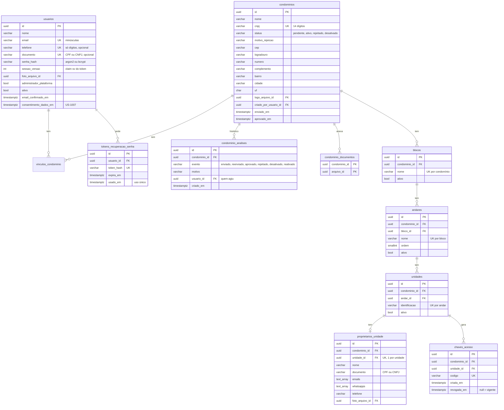
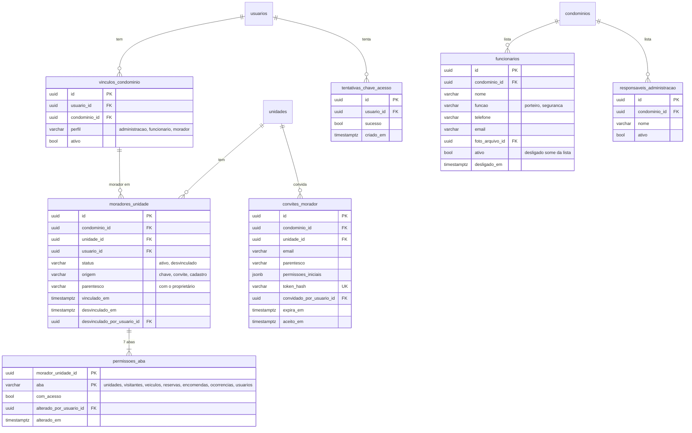
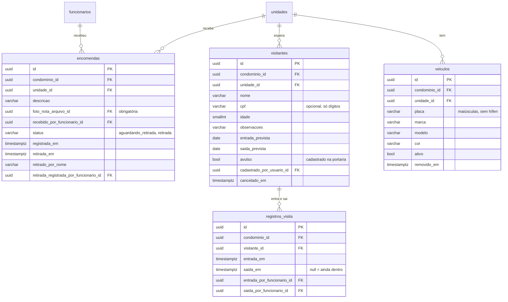
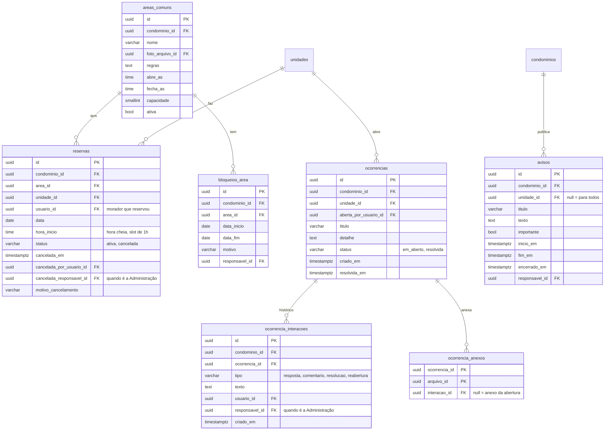
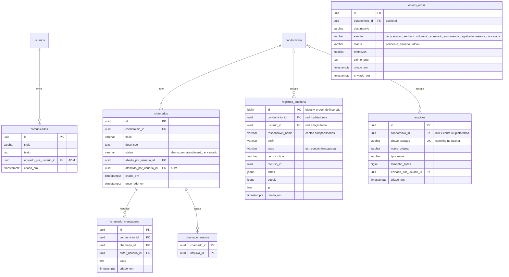

# Modelo de dados (DER lógico)

Status: **v1 para revisão no portão dos leads** (TASK-3, US-1006). Base para a TASK-81 (migrations, constraints e índices).

Fontes: as 52 user stories do Notion, a [matriz de permissões](permissoes-e-multitenant.md) (em especial a seção 12), o [ADR 0002](decisions/0002-isolamento-condominios.md) e a migração `20261015_0001`. Onde este documento muda o que a 0001 criou, isso está na [seção 5](#5-o-que-muda-em-relação-à-migração-0001).

Os diagramas estão em Mermaid: o GitHub os desenha direto nesta página, e o texto é a fonte que se edita.

## 1. Convenções

- Tabelas e colunas em português, `snake_case`, tabelas no plural (como já está no repositório).
- `id uuid` gerado pela aplicação em toda tabela. `criado_em timestamptz default now()` onde a data importa. **Datas de registro não são editáveis**: a aplicação não expõe esses campos para escrita.
- **`condominio_id` obrigatório em toda tabela de negócio**, com FK para `condominios` e índice (R2 da matriz). As únicas exceções são as tabelas da plataforma: `usuarios`, `comunicados` e os registros de `registros_auditoria` e `envios_email` sem condomínio.
- Tabela que aponta para unidade (ou para outro registro do condomínio) usa **FK composta** `(x_id, condominio_id)`, como `vinculos_condominio` já faz. Assim o banco recusa uma unidade de outro condomínio. Para isso, cada tabela referenciada tem `UNIQUE (id, condominio_id)`.
- Status e enums são `varchar` com `CHECK` (padrão da 0001), não tipos `ENUM` do PostgreSQL, porque são mais fáceis de alterar numa migração.
- Nada é apagado de verdade: registros são **desativados** (`ativo = false`, `desativado_em`) ou mudam de status. FKs usam `ON DELETE RESTRICT`.
- Arquivos (fotos, anexos, documentos) ficam no storage. O banco guarda só os metadados em `arquivos` (US-1003).
- CPF, CNPJ, telefone e placa são guardados **só com dígitos/letras, sem máscara**. A máscara é coisa da tela (US-1007).

## 2. Visão geral

| Domínio | Tabelas | Dono do módulo |
| --- | --- | --- |
| Contas e acesso | `usuarios`, `tokens_recuperacao_senha`, `tentativas_chave_acesso` | Gabriel |
| Condomínio e cadastro | `condominios`, `condominio_analises`, `condominio_documentos` | Paulo |
| Estrutura | `blocos`, `andares`, `unidades`, `proprietarios_unidade`, `chaves_acesso` | Paulo / Tude (edição) |
| Vínculos e permissões | `vinculos_condominio`, `moradores_unidade`, `permissoes_aba`, `convites_morador` | Paulo / Gabriel |
| Pessoas sem login | `funcionarios`, `responsaveis_administracao` | Tude |
| Portaria | `encomendas`, `visitantes`, `registros_visita`, `veiculos` | Eduardo / Vitor |
| Convivência | `areas_comuns`, `bloqueios_area`, `reservas`, `ocorrencias`, `ocorrencia_interacoes`, `ocorrencia_anexos`, `avisos` | Vitor / Tude |
| Plataforma | `comunicados`, `chamados`, `chamado_mensagens`, `chamado_anexos`, `registros_auditoria`, `envios_email` | Tude |
| Transversal | `arquivos` | Eduardo |

São 35 tabelas: as 4 da 0001 continuam (com mudanças, seção 5) e 31 são novas.

## 3. Diagramas

Para não poluir os diagramas, `criado_em` só aparece onde tem regra própria, e as FKs para `arquivos` aparecem só como coluna.

### 3.1 Contas, condomínio e estrutura

### 3.2 Vínculos, permissões e pessoas sem login

### 3.3 Portaria

### 3.4 Convivência

### 3.5 Plataforma e transversais

## 4. Regras garantidas pelo próprio banco

Estas são as restrições que a TASK-81 transforma em constraints. As marcadas com ★ são critério de aceite de alguma story.

| # | Regra | Como | Origem |
| --- | --- | --- | --- |
| 1 ★ | Uma reserva **ativa** por unidade, área e dia | `UNIQUE (unidade_id, area_id, data) WHERE status = 'ativa'` (índice parcial) | US-1006, US-603 |
| 2 ★ | Dois pedidos simultâneos para o mesmo horário gravam só um | `UNIQUE (area_id, data, hora_inicio) WHERE status = 'ativa'` | US-603 |
| 3 | Reserva em hora cheia | `CHECK (date_part('minute', hora_inicio) = 0)` | US-603 |
| 4 ★ | Chave de acesso única | `UNIQUE (codigo)` em `chaves_acesso` | US-1006, US-207 |
| 5 | Só uma chave vigente por unidade | `UNIQUE (unidade_id) WHERE revogada_em IS NULL` | US-207 |
| 6 ★ | CNPJ único | `UNIQUE (cnpj)` em `condominios`; `UNIQUE (documento)` em `usuarios` | US-201, US-206 |
| 7 | Status do condomínio válido | `CHECK (status IN ('pendente','ativo','rejeitado','desativado'))` e `CHECK (status <> 'rejeitado' OR motivo_rejeicao IS NOT NULL)` | US-203 |
| 8 | Encomenda coerente | `CHECK` de status (`aguardando_retirada`, `retirada`) e `CHECK ((status = 'retirada') = (retirada_em IS NOT NULL AND retirado_por_nome IS NOT NULL))` | US-401, US-403 |
| 9 | Ocorrência coerente | `CHECK (status IN ('em_aberto','resolvida'))` | US-701, US-703 |
| 10 | Saída só depois da entrada | `CHECK (saida_em IS NULL OR saida_em >= entrada_em)` em `registros_visita` | US-503 |
| 11 | Uma visita em aberto por visitante | `UNIQUE (visitante_id) WHERE saida_em IS NULL` | US-503 |
| 12 | Período do visitante válido | `CHECK (saida_prevista >= entrada_prevista)` | US-501 |
| 13 | Placa no formato brasileiro (antigo ou Mercosul) | `CHECK (placa ~ '^[A-Z]{3}[0-9][A-Z0-9][0-9]{2}$')` | US-502 |
| 14 | Placa não se repete na mesma unidade | `UNIQUE (unidade_id, placa) WHERE ativo`. Entre unidades **pode** repetir: a story pede só um aviso à Administração | US-502 |
| 15 | Bloqueio com intervalo válido | `CHECK (data_fim >= data_inicio)` | US-602 |
| 16 | Área com horário válido | `CHECK (fecha_as > abre_as)` e `CHECK (capacidade > 0)` | US-601 |
| 17 | Aviso com período válido | `CHECK (fim_em > inicio_em)` | US-801 |
| 18 | Estrutura sem nomes repetidos | `UNIQUE (condominio_id, nome)` em blocos, `UNIQUE (bloco_id, nome)` em andares, `UNIQUE (andar_id, identificacao)` em unidades | US-202, US-205 |
| 19 | Morador não se vincula duas vezes à mesma unidade | `UNIQUE (unidade_id, usuario_id) WHERE status = 'ativo'` | US-301 |
| 20 | Toda aba existe para cada morador | `CHECK (aba IN (...7 abas...))` e PK `(morador_unidade_id, aba)` | US-304 |
| 21 ★ | Auditoria só aceita inserção | trigger `BEFORE UPDATE OR DELETE` que lança erro em `registros_auditoria` | US-1004, US-903 |
| 22 | Isolamento entre condomínios | FK composta `(x_id, condominio_id)` em toda referência a unidade, área, visitante, ocorrência, chamado, funcionário e responsável | US-1001 |
| 23 | E-mail e tokens de uso único | `UNIQUE (token_hash)` e `usado_em`/`aceito_em` preenchidos só uma vez | US-102, US-303 |

Regras que **não** dá para garantir no banco e ficam no service (com teste): limite de tentativas de chave (US-301, usa `tentativas_chave_acesso`), horário dentro do funcionamento da área e fora de bloqueio (US-603), última pessoa com a aba Usuários (matriz, seção 8), encomenda só para unidade ativa, e o filtro por `condominio_id` em toda consulta (R3).

### Índices para as consultas mais usadas

Além do índice em `condominio_id` de cada tabela:

- `encomendas (condominio_id, status, registrada_em DESC)` e `(unidade_id, registrada_em DESC)`: lista do morador e relatório (US-402, US-404).
- `reservas (area_id, data)`: grade do dia (US-603).
- `ocorrencias (condominio_id, status, criado_em DESC)`: fila da Administração (US-703).
- `visitantes (condominio_id, nome)` e `veiculos (condominio_id, placa)`: busca na portaria (US-503, US-505).
- `avisos (condominio_id, inicio_em, fim_em)`: avisos vigentes (US-802).
- `registros_auditoria (condominio_id, criado_em DESC)`: consulta do ADM com filtros (US-903).
- `envios_email (status) WHERE status <> 'enviado'`: fila de reenvio (US-803).

## 5. O que muda em relação à migração 0001

A 0001 já foi aplicada por todo mundo, então **não será editada**: as mudanças entram numa migração nova.

| Tabela | Mudança | Por quê |
| --- | --- | --- |
| `usuarios` | + `telefone`, `documento`, `senha_hash`, `sessao_versao`, `foto_arquivo_id`, `email_confirmado_em`, `consentimento_dados_em` | Login (US-101), conta da Administração com CPF/CNPJ (US-201), derrubar sessões (US-210), LGPD (US-1007) |
| `condominios` | `ativo bool` vira `status`; + `cnpj`, endereço, `logo_arquivo_id`, `motivo_rejeicao`, `criado_por_usuario_id`, `enviado_em`, `aprovado_em` | Fluxo de aprovação (US-202 a US-208) |
| `unidades` | + `andar_id` (FK composta), `ativo`; o `UNIQUE (condominio_id, identificacao)` vira `UNIQUE (andar_id, identificacao)` | Estrutura bloco/andar (US-202) e o "101" que se repete em blocos diferentes |
| `vinculos_condominio` | a coluna `unidade_id` deixa de ser usada e sai numa migração seguinte | Um morador pode ter várias unidades (US-301), cada uma com suas permissões (US-304). A unidade passa para `moradores_unidade` |

O `vinculos_condominio` continua sendo **"esta conta atua neste condomínio com este perfil"**, e é o que o login usa (matriz, seção 4). Para o Morador, as unidades ficam em `moradores_unidade`. Isso muda a consequência registrada no ADR 0002, e por isso está no [ADR 0003](decisions/0003-moradores-em-varias-unidades.md).

## 6. Decisões tomadas aqui (confirmar na revisão)

1. **Reserva é por slot de 1 hora** (`data` + `hora_inicio`), e não por intervalo livre. Segue a grade de 1 hora da US-603 e deixa as regras 1 e 2 simples de garantir.
2. **Visitante e visita são tabelas separadas.** O cadastro do morador vale por um período (US-501) e o porteiro pode registrar mais de uma entrada nesse período.
3. **Funcionários e responsáveis da Administração não são usuários** (matriz, seção 2). A conta compartilhada de cada perfil é um `usuario` comum com um `vinculo_condominio`.
4. **Auditoria com `bigint` em vez de `uuid`**, para a ordem de inserção ser natural e a tabela crescer sem custo.
5. **`proprietarios_unidade` separado de `unidades`**, porque tem muitos campos, foto e dados pessoais que só a Administração vê.
6. **Aviso pode ter `unidade_id`**: é como a Administração avisa uma unidade de reserva cancelada (US-605, US-602) sem criar uma tabela de notificações.
7. **Chave de acesso guardada em texto**, porque a Administração precisa consultá-la (US-207). A chave nunca é devolvida ao morador.

## 7. Pontos em aberto

- **Conflito entre a TASK-81 e as stories:** a task de migrations fala em "constraint única de reserva: (área, data) por condomínio", o que deixaria uma única reserva por área por dia no prédio inteiro. A US-603 e a US-1006 dizem **uma por unidade, área e dia**, com grade de horários. Este DER segue as stories (regras 1 e 2). Ajustar o texto da TASK-81.
- **Login da conta compartilhada de Funcionários** (US-210 fala em "usuário e senha"): é um e-mail/telefone como as outras contas, ou um nome de usuário próprio? Este DER assume e-mail.
- **Permissões iniciais do morador:** a regra proposta na matriz (primeiro morador com tudo, os seguintes sem a aba Usuários) ainda depende do Paulo.
- **Comunicados lidos:** a US-804 não pede controle de leitura, então não há tabela para isso.

## 8. Revisão por módulo

Pronto quando cada dono confirmar as suas tabelas e os leads aprovarem no portão da Sprint 0.

- [ ] Gabriel: isolamento (convenções e regra 22), `usuarios`, vínculos e `permissoes_aba`
- [ ] Paulo: condomínio, cadastro, estrutura, chaves e `moradores_unidade`
- [ ] Vitor: áreas, reservas e ocorrências
- [ ] Tude: funcionários, responsáveis, avisos, chamados, comunicados, auditoria e e-mail
- [ ] Eduardo: encomendas, visitantes, veículos e `arquivos`
